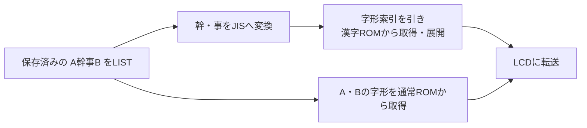

# PC-1360K 漢字ROMの全体像

2026-11-24、観測226までの概説。読みから変換候補を選ぶ処理は辞書と追加ワークRAMを使う。候補や保存済み文字を画面に描く処理は、文字コードから字形を引いてLCDへ送る。

## 1. 漢字ROMへのアクセス

`0x3600` で漢字ROMのselectorを選び、READ/READMがDPの指す位置を読む。selector 0〜3の論理4領域、計256 KiBを実機から回収済み。通常ROMのバンク選択には `0x3400` を使う。

## 2. 漢字ROMに入っているもの

- **辞書索引と辞書データ（selector 2/3で確認）**。読みを手がかりに辞書項目を探し、変換候補を得る。
- **字形索引と字形データ（selector 0/1の経路で確認）**。文字コードから字形の格納位置を引き、描画用のデータを読む。字形索引はselector 0にある。

## 3. 追加ワークRAMの使い方

`0x2000–0x27FF` は検索結果、組み立てた候補、選択状態、履歴の管理に使う。以下は代表アドレス。

| 用途 | 代表アドレス | いつ使うか |
| --- | --- | --- |
| 辞書の検索結果 | `0x2053` 元表、`0x2381` 別表 | 変換時に読みと辞書項目を結び付ける。検索ごとに有効範囲を更新する。 |
| 候補の組立てと選択 | `0x257F` ワーク列、`0x26E4` 群リスト、`0x2040–0x2052` 選択管理 | 変換で候補を組み立て、候補送りで選択位置を進める。採用後も値がRAMに残る場合がある。 |
| 候補履歴 | `0x26FA–0x26FD` 管理、`0x2700–0x27FF` 記録 | 通常の候補送りや▲▼側の番号選択で保存する。通常のCLEAR後も残り、次回の変換で候補を優先表示する。 |

▲▼側の変換は候補表 `0x2100`・`0x2200` を使い、履歴リングを通常変換と共有する。保存済み文字列をLIST・PRINTした実測例では追加ワークRAMへの読書きは観測されなかった。

## 4. 読み入力から文字確定まで

読みと候補文字列には、追加ワークRAMの外にある `0xFB29` 側と `0xFB7C` 側を使う。採用後にBASIC行として保存する場合は、行を整えてENTERで登録する。

## 5. 文字コードから字形表示まで

例えば「幹」は保存コード `8A B2` からJIS `0x3434` へ変換される。通常ROMのbank 1、`0x5013` から字形取得へ進み、読み出した圧縮データを `0xFEB0` の32バイトの字形バッファへ展開する。

詳細と実測条件は[ROMアクセスと字形](../../reference/machines/PC-1360K.md)、[動作解説](../../reference/machines/PC-1360K_KANJI_RUNTIME.md)、[ワークの観測記録](KANJI_WORK_MEMORY.md)、[履歴仕様](HISTORY_SPEC_STATUS.md)を参照。
